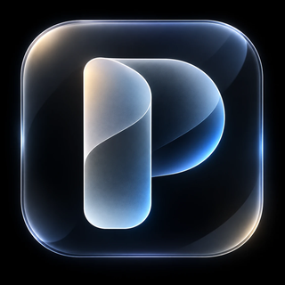
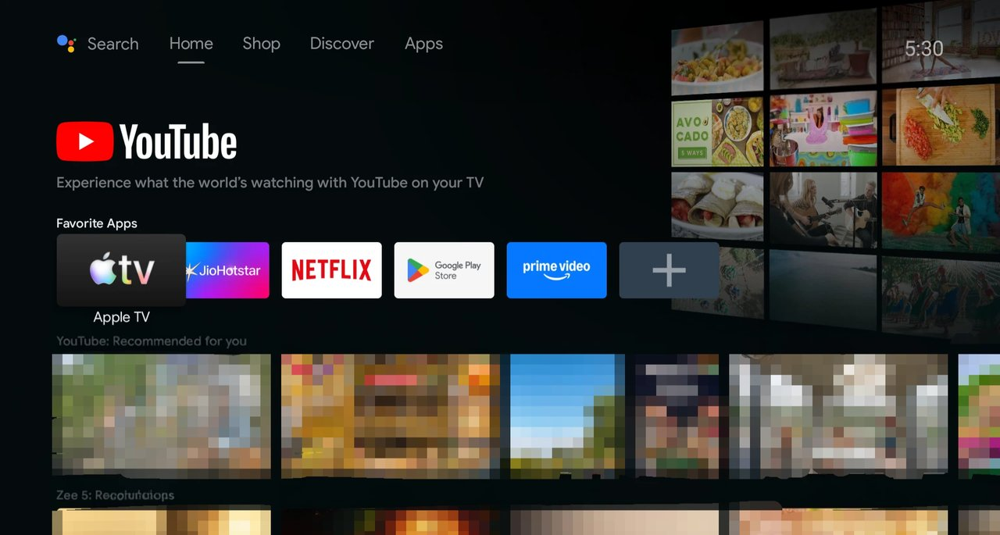
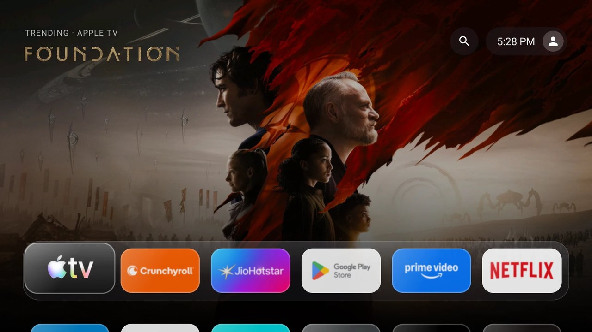
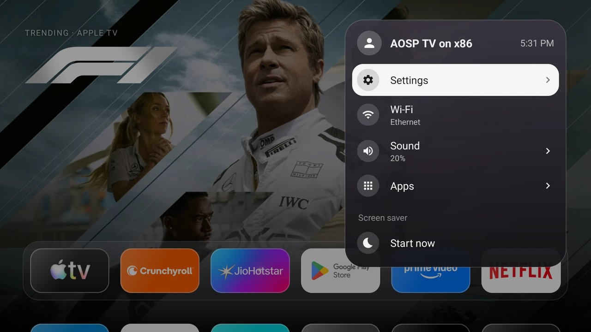

<p align="center">
  
</p>

# PureDeck

An ad-free home screen for Android TV. Big rotating backdrop, a glass dock, plain rows of apps, and nothing sponsored anywhere.

I built it for my two TVs, one on Android TV 8 and the other on Google TV, because the stock launchers keep filling the home screen with promoted content I never asked for and make the TV slow.

| Stock launcher                                         | PureDeck home                               | PureDeck UI                                         |
| ------------------------------------------------------ | ------------------------------------------ | -------------------------------------------------- |
|  |  |  |

## What it does

- **Hero backdrop that follows focus.** Move over a streaming app and the background changes to that service's recently added and trending titles for your country. The title is drawn with the show's own logo, or with plain lettering when it has none.
- **Glass dock** for your favourite apps, and a clean grid for everything else.
- **Search** across movies and shows. A result shows the plot, rating and where it streams in your country, and "Open" jumps straight into the title inside Netflix, Prime Video and other apps that allow it.
- **Its own settings card** for the clock, Wi-Fi, Bluetooth, screensaver and sorting apps.
- **No ads, no accounts, no analytics.**

## Supported streaming apps

These get the hero backdrop with recently added and trending titles (for your region), and search can open their titles directly:

| App                          | Hero | "Open" from search |
| ---------------------------- | :--: | :----------------: |
| Netflix                      | yes  |        yes         |
| Prime Video                  | yes  |        yes         |
| JioHotstar / Disney+ Hotstar | yes  |        yes         |
| Disney+                      | yes  |        yes         |
| Apple TV                     | yes  |        yes         |
| SonyLIV                      | yes  |        yes         |
| ZEE5                         | yes  |        yes         |
| Crunchyroll                  | yes  |        yes         |
| YouTube/ Any other apps      |  no  |        yes         |

Every other app still gets a hero: its own banner, blurred, with the app's name. Which titles show depends on what JustWatch and TMDB report for your region, so a smaller service can have a short list. "Open" lands on the exact title only where the app supports that link; otherwise it opens the app's home screen.

## Install

You need an Android TV with Android 8.0 or newer, and a way to get the APK onto it.

**The release APK is ready to use as it is.** Install it and the catalogue works straight away, with no accounts, API keys or servers to set up. It's built for India (`IN`) and uses my backend. If you want another country, your own limits, or don't want to depend on my server, see [Use your own backend](#use-your-own-backend-optional) below.

### With a computer (ADB)

1. On the TV: Settings → Device Preferences → About, tap **Build** seven times. Then open Developer options and switch on **USB debugging** (some TVs call it **Network debugging**).
2. Find the TV's IP address under Settings → Network.
3. From your computer:

   ```bash
   adb connect 192.168.1.XX:XXXX      # use your TV's address
   adb install -r PureDeck.apk
   ```

   Get `PureDeck.apk` from the [Releases page](https://github.com/Martian005/PureDeck/releases/latest).

### Let an AI agent install it

Don't want to type the commands yourself? Paste one of these prompts into Claude Code or Codex on a computer that shares the TV's Wi-Fi. Swap in your TV's address first.

**Claude Code**

```text
Install the PureDeck Android TV launcher on my TV. The TV's IP is 192.168.1.XX and ADB debugging is already switched on.
1. Download https://github.com/Martian005/PureDeck/releases/latest/download/PureDeck.apk to a new empty folder.
2. Make sure adb is installed. If it isn't, tell me how to get it.
3. Run: adb connect 192.168.1.XX:XXXX, then adb install -r PureDeck.apk, and confirm it says Success.
4. Start it with: adb shell am start -n com.puredeck.launcher/.MainActivity
5. Stop there. Do not disable or change anything else on the TV. Tell me how to make it the default home screen and how to undo that, and wait for me to say yes before running any of it.
```

**Codex**

```text
Task: install the PureDeck Android TV launcher on my TV over ADB.
TV address: 192.168.1.XX:XXXX (network debugging is already on).
Steps: download https://github.com/Martian005/PureDeck/releases/latest/download/PureDeck.apk into an empty directory, run `adb connect 192.168.1.XX:XXXX`, then `adb install -r PureDeck.apk`, then launch it with `adb shell am start -n com.puredeck.launcher/.MainActivity`.
Check each command succeeded before the next one. Do not run any other adb command, and do not disable any package. When done, explain how to make PureDeck the default home screen and how to revert, and wait for my confirmation before doing it.
```

## Make it your home screen

Installing is not enough. Android keeps asking the stock launcher to come back, so on most TVs you have to switch it off for your user. This is REVERSIBLE, but read the *warning* below first.

```bash
# Android TV (older models)
adb shell pm disable-user --user 0 com.google.android.tvlauncher

# Google TV (newer models)
adb shell pm disable-user --user 0 com.google.android.apps.tv.launcherx
```

Press Home and pick PureDeck, tick "always".

To go back:

```bash
adb shell pm enable com.google.android.tvlauncher
adb shell pm enable com.google.android.apps.tv.launcherx
```

> **Keep ADB working before you do this.** With the stock launcher off and no way to reach ADB, a broken launcher can leave you with a TV you can't navigate. Confirm `adb devices` lists your TV, and leave network debugging on until you are happy with it.

## Optional: Debloat your TV

Not needed for PureDeck to work. Skip it if you're happy with what's installed.

TVs ship with a lot of apps you may never open, and they eat RAM. You can switch them off without deleting anything, so every change can be undone. You can do it yourself or let an AI agent walk you through it.

### Using ADB

```bash
adb shell pm list packages            # see what's installed
adb shell pm disable-user --user 0 PACKAGE_NAME
```

Undo any of them with:

```bash
adb shell pm enable PACKAGE_NAME
```

Go one app at a time and check the TV still behaves before the next. Good candidates are movie and music store apps, tutorials, bug-report senders, backup helpers, and the maker's shop, help and recommendation apps.

### With an AI agent, one approval at a time

Paste this into Claude Code or Codex on a computer that shares the TV's Wi-Fi. It changes nothing until you say yes.

```text
Help me debloat my Android TV so it runs faster. Network debugging (ADB over Wi-Fi) is already on; my TV's address is 192.168.1.XX:XXXX.

Work in this order:
1. Connect with adb over Wi-Fi and confirm the TV answers.
2. Before changing anything, record the free RAM (adb shell dumpsys meminfo).
3. List every installed app in plain English, sorted into three groups:
   (a) safe to turn off, (b) needed by the TV, (c) apps I probably use.
   Say what each one does. If you're not sure which group an app belongs in, put it in (b).
4. Go through group (a) one batch at a time. Show me the batch, wait for my yes, then turn those apps off with
   adb shell pm disable-user --user 0 PACKAGE. Never uninstall anything. After each batch, check the TV still responds.
5. Keep a file called debloat-log.md with every app you turned off and the exact command that turns it back on
   (adb shell pm enable PACKAGE).

Never touch: Google Play Services (com.google.android.gms), Google Play Store, Settings, System UI, setup apps,
the keyboard, Bluetooth, my HDMI inputs, the TV input and tuner framework, any launcher (including PureDeck),
or anything else the TV needs to boot. When in doubt, leave it on.

Optional, ask me first: turn off window/transition animations and the screensaver, and set the TV to sleep after 5 minutes.

When finished, reboot the TV, reconnect, record the free RAM again, and tell me the before and after numbers
along with where debloat-log.md is.
```

**Never switch off:** Google Play (Store and Services), your keyboard, Bluetooth, or anything that handles your HDMI inputs. Disable, don't uninstall. This carries the same risk as everything else here; see the note at the bottom.

## How the catalogue works

The TV never talks to TMDB directly. On my Android TV 8 set every call to TMDB times out, while my Google TV on the same Wi-Fi reaches it fine. I never fully pinned down why; my guess is the older TV's network handling combined with my ISP's DNS. Shipping an API key inside an APK is a bad idea anyway. So there is a small backend in [`api/`](api), and the app only calls that. The release APK already uses mine, so you don't have to do anything; the code is here so you can run your own. It works the same on both TVs.

```
TV  ->  the backend (mine, or your own on Vercel)  ->  TMDB (art, logos, search, details)
                                                  ->  JustWatch (what was added or is trending in your country)
```

- Where a show streams, and what is new or trending in each country, comes from JustWatch's public GraphQL endpoint. It is unofficial and can change without notice. If it breaks, the app falls back to TMDB's own lists.
- Posters, backdrops, title logos, search and details come from [TMDB](https://www.themoviedb.org).

My backend runs on a separate, free-tier Vercel project with its own TMDB key, kept apart from anything personal. It's a free hobby server, so it can be slow, rate limited, or switched off at any time. If that happens, or you want a different country, run your own. It's free and takes about ten minutes.

## Use your own backend (optional)

You only need this if you don't want to use the ready-made APK as is. The steps are: get a TMDB key, deploy `api/` to Vercel, then build the app pointing at your deployment (see [Build it yourself](#build-it-yourself)).

### Get a free TMDB API key

1. Create an account at [themoviedb.org](https://www.themoviedb.org/signup).
2. Go to Settings → API ([direct link](https://www.themoviedb.org/settings/api)) and request a key for personal use. Fill the short form; "personal, non-commercial" is fine.
3. Copy the **API Key (v3 auth)**. Not the long "Read Access Token".

Details and the exact endpoints I use are in [docs/TMDB.md](docs/TMDB.md).

### Deploy your backend

Short version (full steps in [docs/DEPLOY-BACKEND.md](docs/DEPLOY-BACKEND.md)):

1. Fork this repo and import it in [Vercel](https://vercel.com) as a new project.
2. Add one environment variable: `TMDB_API_KEY` = your v3 key. Redeploy.
3. Open `https://YOUR-PROJECT.vercel.app/api/catalogue?provider=8&region=YOUR_REGION_CODE`. You should get JSON with an `items` list.
   `region` is a two-letter country code (`IN`, `US`, `GB`, ...).

## Build it yourself

You need Android Studio (or JDK 17+ and the Android SDK).

```bash
git clone https://github.com/Martian005/PureDeck.git
cd PureDeck
cp local.properties.example local.properties
# edit local.properties: sdk.dir, catalogue.baseUrl, tmdb.region
./gradlew assembleRelease
```

The APK lands in `app/build/outputs/apk/release/`. `local.properties` is git-ignored; don't commit it.

Only want to test without a backend? Leave `catalogue.baseUrl` empty and set `tmdb.apiKey` instead. The app then calls TMDB straight from the TV, and the key ends up inside the APK, so don't share that build.

Region is the two-letter country code in `tmdb.region` (`IN`, `US`, `GB`, ...).

## Known limits

- Opening a title directly depends on each app's own link support. Netflix and Prime work on my TVs. Others may only open the app's home screen.
- Tested mostly on the Android TV 8 set. The Google TV has had less testing.
- The release APK is signed with a debug key. That is fine for sideloading, but an update signed with a different key won't install over it; uninstall first if that happens.

## Use at your own risk

This is a hobby project, shared as is. It changes which app your TV treats as its home screen, and the steps above involve disabling a system app. If something goes wrong (blank home screen, a TV you can't navigate, a factory reset) that's on you, not me. Keep ADB access, know how to undo each step, and don't try it on a TV you can't afford to reset.


## Built with AI assistance

I designed PureDeck, chose what it should do, and tested it on my own TVs. The code was written with the help of an AI assistant, and I reviewed and tweaked it along the way.
## Credits

The look is inspired by Apple's tvOS. PureDeck is an independent project.

This product uses the TMDB API. Watch-availability data comes from JustWatch.
